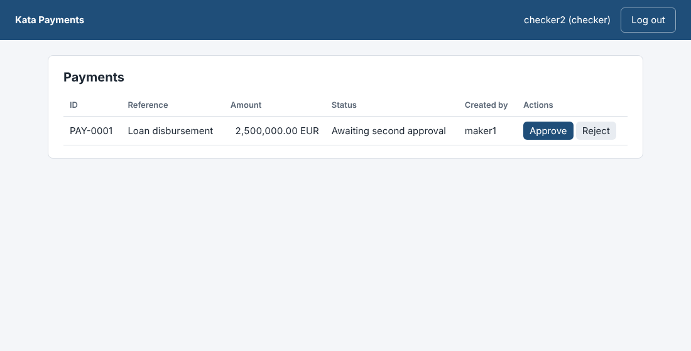
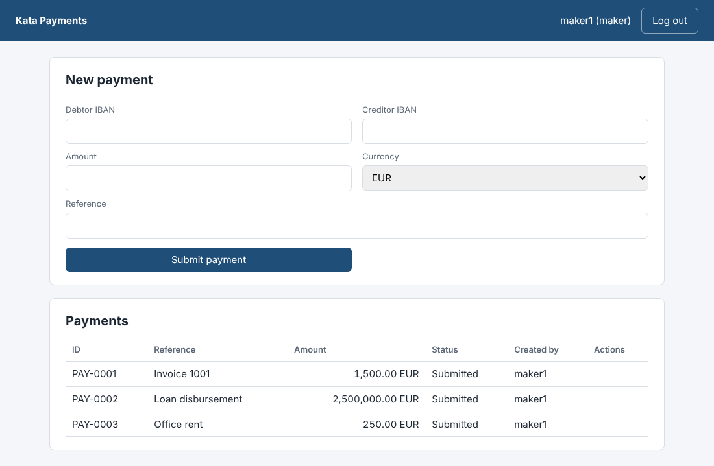
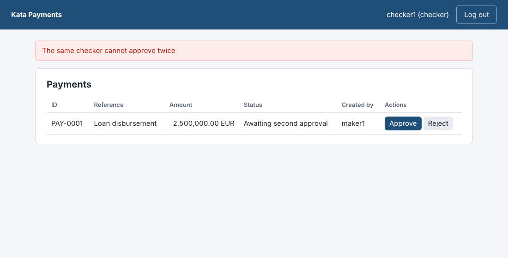
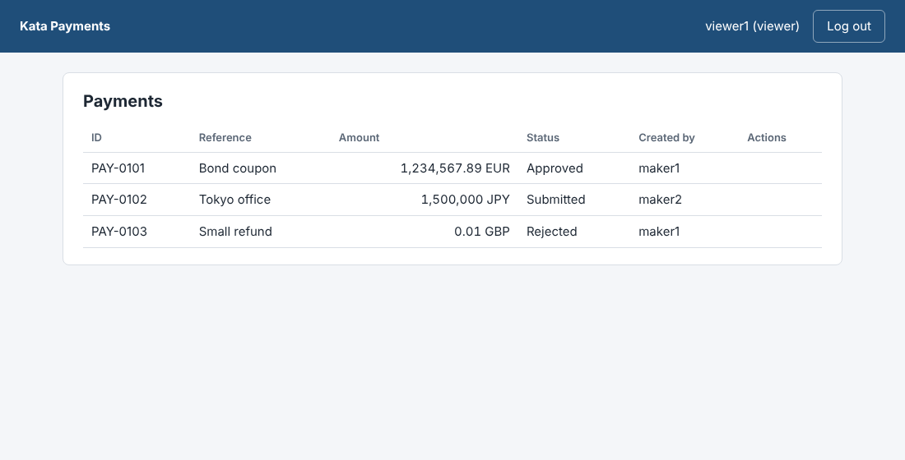
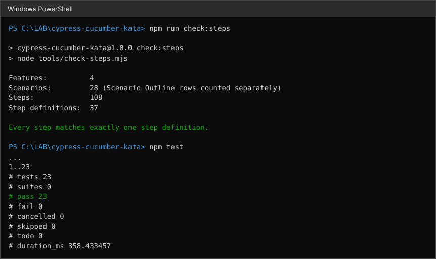

# cypress-cucumber-kata

[](https://github.com/ViktorVakareev/cypress-cucumber-kata/actions/workflows/tests.yml)


A **Cypress + Cucumber (BDD) test suite in TypeScript** for a small payments application with **maker-checker approval, IBAN validation and a REST API**. It covers the UI, the API and the network layer, and runs in GitHub Actions.

I built it while moving from my daily stack (C#/.NET, Selenium/Bellatrix, NUnit) to Cypress and Cucumber. The problems are the same ones I've solved for five years: waiting for state instead of time, stable selectors, independent test data and a suite you can trust. Only the syntax changes. [LEARNING.md](LEARNING.md) is the step-by-step guide I learn from, with exercises.



## What it shows

| Skill | Where |
|---|---|
| Gherkin features: Background, Scenario Outline + Examples, data tables, tags | `cypress/e2e/features/*.feature` |
| Thin TypeScript step definitions over page objects and custom commands | `cypress/support/step_definitions/`, `cypress/support/pages/` |
| `cy.session()`: log in once per user, cached and validated across tests | `cypress/support/commands.ts` (`loginByApi`) |
| `cy.intercept()`: wait on real API calls, stub failures, delay responses, replace data with fixtures | `payments-ui.steps.ts`, `network.steps.ts` |
| `cy.request()`: API tests (status codes, headers, error contract, idempotency, auth) and fast test-data setup | `payments-api.feature`, `api.steps.ts`, `commands.ts` |
| Custom commands with TypeScript types | `cypress/support/commands.ts` |
| Test independence: every scenario resets the data and creates its own | `step_definitions/hooks.ts` |
| Tag filtering (`@smoke`, `@api`, `@ui`, `@network`) | `npm run e2e:smoke`, `--expose tags=...` |
| CI: unit tests, typecheck and a step-definition check, then Cypress in Chrome, with the Cucumber HTML report as an artifact | `.github/workflows/tests.yml` |
| A Gherkin dry run without a browser: undefined or ambiguous steps fail the build | `tools/check-steps.mjs` |

## The application under test

`app/` holds **Kata Payments**, a deliberately small app written for this kata (Node.js, no dependencies). It has real business rules, so the tests have something worth testing:

- **Roles:** makers create payments, checkers approve or reject them, viewers only read.
- **Maker-checker:** payments of **1,000,000.00 or more need two different checkers**. The same checker can't approve twice (409).
- **Validation:** IBANs with mod-97 checksum, amounts as decimal strings stored in integer minor units (no floating point), currency precision (EUR/USD/GBP 2 decimals, JPY none), limit 10,000,000.
- **API:** cookie login for the browser, bearer tokens for API clients, `Location` header on 201, a consistent error body `{ error: { code, message, field } }`, `Idempotency-Key` support, and a test-only reset endpoint (`--test-mode`).

| Maker view | Second checker | Fixture data via `cy.intercept` |
|---|---|---|
|  |  |  |

## Quick start (Windows PowerShell)

Requires Node.js 22 or newer.

```powershell
git clone https://github.com/ViktorVakareev/cypress-cucumber-kata.git
cd cypress-cucumber-kata
npm ci

# Everything in one go: start the app, wait for it, run all features headless, stop the app
npm run e2e

# Or interactively: start the app in one terminal...
npm run start:test
# ...and open the Cypress runner in another
npm run cy:open
```

Other commands:

| Command | What it does |
|---|---|
| `npm run e2e:smoke` | Only scenarios tagged `@smoke` |
| `npx cypress run --expose tags="@api"` | Only the API feature (any [tag expression](https://cucumber.io/docs/cucumber/api/#tag-expressions), e.g. `"@ui and not @smoke"`) |
| `npm test` | The app's own unit and API tests (node:test) |
| `npm run typecheck` | TypeScript check of the whole suite |
| `npm run check:steps` | Gherkin dry run: every step must match exactly one step definition |
| `npm start` | The app on http://localhost:3000. Log in as `maker1`, `checker1`, `checker2` or `viewer1`, password `kata-pass-1` (local demo only) |

After `npm run e2e`, the Cucumber HTML report is in `reports/cucumber-report.html`.

The fast checks run before any browser starts (the first CI job):



## How it works

```
 .feature (Gherkin)  ->  @badeball/cypress-cucumber-preprocessor  ->  esbuild bundle  ->  Cypress test
                              |
          step definitions (TypeScript, thin)
                              |
        page objects  +  custom commands (getByCy, loginByApi, apiToken, createPayment, approveAs)
                              |
              Kata Payments: UI (data-cy attributes)  +  REST API (/api/...)
```

Three choices make the suite fast and stable:

1. **Data through the API, the UI only for the step under test.** A "Given maker1 has submitted a payment" step is a `cy.request`, not ten clicks. The browser stays logged in as the checker, because API clients log in with `{"cookie": false}` and a bearer token.
2. **Wait for state, never for time.** No `cy.wait(5000)` anywhere: retrying assertions (`should("have.text", ...)`) and intercept aliases (`cy.wait("@approve")`).
3. **Every scenario is independent.** A `Before` hook clears the payments; each scenario creates exactly what it needs. Logins survive the reset, so `cy.session()` caching still works.

## Scenarios

| Feature | Scenarios | Covers |
|---|---|---|
| `login.feature` | 5 (3 from one outline) | Each role signs in, wrong password, sign out |
| `payments-ui.feature` | 7 | Maker submits (201), invalid IBAN (400 + message), viewer has no form, approve, reject, second checker, same checker twice |
| `payments-api.feature` | 13 (7 from one outline) | 201 + Location, amount and currency boundaries, field-level error, 401, 403, idempotency, 409 |
| `network.feature` | 3 | API failure banner, loading state on a slow response, formatting with fixture data |
| **Total** | **28 scenarios, 108 steps, 37 step definitions** | |

## Project structure

```
app/                         Kata Payments (app under test): domain.js, server.js, public/
cypress/
  e2e/features/              *.feature files (Gherkin)
  fixtures/                  payments-list.json (used with cy.intercept)
  support/
    commands.ts              custom commands + their TypeScript types
    e2e.ts                   support file loaded before every feature
    pages/                   LoginPage, PaymentsPage
    step_definitions/        hooks.ts + *.steps.ts
    types.ts                 API shapes and a default valid payment
test/                        node:test tests for the app (domain rules + HTTP API)
tools/check-steps.mjs        Gherkin dry run (undefined / ambiguous / unused steps)
cypress.config.ts            Cypress + Cucumber preprocessor + esbuild
LEARNING.md                  learning path and exercises
```

## Lessons learned

- **Cypress commands are queued, not promises.** `cy.get()` doesn't return an element; work with values in `.then()`, share them between steps with aliases (`.as("paymentId")` → `cy.get("@paymentId")`).
- **Register `cy.intercept` before the action that triggers the request**, then `cy.wait("@alias")`. Intercepts for the first page load must come before `cy.visit`, which is why the network steps are `Given` steps placed before the login step.
- **Match intercepts precisely.** `{ method: "GET", pathname: "/api/payments" }` matches the list only, not `/api/payments/PAY-0001/approve`.
- **`cy.session` needs `validate`.** Without it, a server restart leaves a cached but dead cookie and every test fails at the first API call.
- **Don't log in through the API in a way that overwrites the browser's cookie.** That's why the app supports `{"cookie": false}` for API clients.
- **Cypress 16 split configuration:** secrets in `env`, read with `cy.env([...])`; public values in `expose`, read with `Cypress.expose()`. The Cucumber tag filter is passed with `--expose tags=...` (it was `--env tags=...` before Cypress 15.17).
- **Money is never a float.** The app stores minor units; the tests check `0.01`, `10000000.00`, `10000000.01`, `1.005` and JPY without decimals.
- **BDD is worth it when the business reads the features.** The scenarios here describe behaviour ("A large payment needs a second, different checker"), not clicks.

## Credits

- [Cypress](https://www.cypress.io/) and [@badeball/cypress-cucumber-preprocessor](https://github.com/badeball/cypress-cucumber-preprocessor) (MIT).
- The sample IBANs are the standard published examples (BG, DE, GB). All names, references and data are invented.

## License

[MIT](LICENSE)
